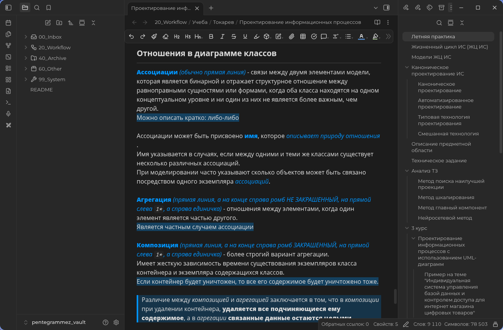

# Default+ Obsidian Theme

Минималистичная тема для Obsidian с динамической системой цветов на базе HSL. Позволяет легко менять акцентный цвет всего интерфейса и элементов разметки в пару кликов.



## ✨ Особенности

- **Динамический HSL-акцент:** Весь дизайн завязан на три переменные (`--accent-h`, `--accent-s`, `--accent-l`). Изменив их, вы перекрасите заголовки, цитаты, жирный текст и даже курсор ввода.
- **Акцентная типографика:** Жирный и курсивный текст используют акцентный цвет, что делает их легко различимыми при чтении.
- **Стильные цитаты:** Блоки цитат (`>`) имеют толщину рамки в 4px, полупрозрачный фон (20%) и курсивное начертание.
- **Мягкие выделения:** Подсветка текста (`==`) и встраиваемые заметки (`![[...]]`) используют акцентный цвет с прозрачностью 30% и 2.5% соответственно, не перебивая основной текст.
- **Минималистичные таблицы:** Полностью прозрачный фон таблиц, тонкие рамки (1px) и заголовки, окрашенные в акцентный цвет.
- **Строгая геометрия:** У всех изображений (`img`) убран радиус скругления (`border-radius: 0px`), а SVG-иконки имеют квадратные окончания линий (`stroke-linecap: square`).
- **Интерфейс:** Убраны лишние полоски у активных вкладок, а отступы в контекстных меню приведены к единому аккуратному виду.
- **Кастомные иконки:** PDF-файлы имеют красный бейдж (`#ef5350`). Также добавлена стилизация для плагина Calendar.

## 🚀 Установка

### Как CSS-сниппет (Рекомендуемый)
1. Скачайте файл `theme.css`.
2. Поместите его в папку `.obsidian/snippets/` вашего хранилища.
3. В Obsidian перейдите в `Настройки` -> `Внешний вид` -> `CSS-сниппеты`.
4. Нажмите кнопку обновления (круглая стрелка) и включите переключатель напротив файла.

### Как полноценная тема
1. Скачайте папку репозитория.
2. Переместите её в `.obsidian/themes/`.
3. Выберите тему в настройках Obsidian.

## 🎨 Как менять цвета

Вся тема строится на трех переменных в начале файла `theme.css`. Чтобы изменить цветовую гамму, отредактируйте блок `body`:

```css
body {
	/* Акцентный цвет по умолчанию (сейчас — ярко-голубой) */
	--accent-h: 205; /* Оттенок (0-360) */
	--accent-s: 100%; /* Насыщенность (0-100%) */
	--accent-l: 50%;  /* Яркость (0-100%) */